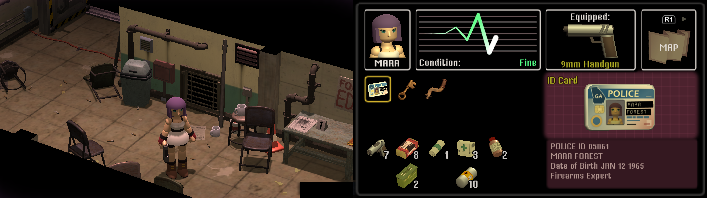

# CrowCountryCamEffectOff



A BepInEx plugin that disables all camera filters (CRT, PSX, SFB, grain, noise) in Crow Country.

## Requirements

- [BepInEx 5.4.23+](https://github.com/BepInEx/BepInEx) installed in your Crow Country directory
- [.NET SDK 6.0+](https://dotnet.microsoft.com/download) (only for building from source)

## Installation

**Easiest: download the pre-built DLL from [Latest Release](https://github.com/LucianoSkx/CrowCountryNoFilter/releases/latest) and drop into `BepInEx/plugins/`.**


### Windows

1. Install BepInEx 5.4.23+ to your Crow Country folder
2. Copy `CrowCountryCamEffectOff.dll` to `BepInEx/plugins/`
3. Run the game once to generate the config
4. Edit `BepInEx/config/luciano.crowcountry.camoff.cfg` if needed

### Linux (Proton/Wine)

1. Install BepInEx 5.4.23+ to your Crow Country folder
2. Copy `CrowCountryCamEffectOff.dll` to `BepInEx/plugins/`

3. Add this to the Steam launch option for Crow Country:
   ```
   WINEDLLOVERRIDES="winhttp=n,b" %command%
   ```
   Or register permanently in the Wine prefix with:
   ```
   STEAM_COMPAT_APP_ID=1996010 \
   STEAM_COMPAT_DATA_PATH="/path/to/CrowCountry/compatdata/1996010" \
     proton run reg.exe add \
     "HKCU\\Software\\Wine\\AppDefaults\\Crow Country.exe\\DllOverrides" \
     /v winhttp /t REG_SZ /d native,builtin /f
   ```

4. Run the game once to generate the config
5. Edit `BepInEx/config/luciano.crowcountry.camoff.cfg` if needed

## Configuration

| Key | Default | Description |
|-----|---------|-------------|
| `Disable All Filters` | `true` | Set to `false` to re-enable filters |

## Building from Source

### Windows (PowerShell)

```powershell
.\build.ps1
```

### Linux / macOS

```bash
chmod +x build.sh
./build.sh
```

Usually the script auto-detects common install paths. Override if needed:

```bash
GameDir="/path/to/Crow Country" ./build.sh
```

## How It Works

Patches `OnRenderImage` on `CrowCountryCamEffect`, `PSXEffects`, and `CRTEffect` to blit the source render texture directly to the destination, bypassing all filter processing. Also disables the components themselves.

## License

[MIT](LICENSE)
